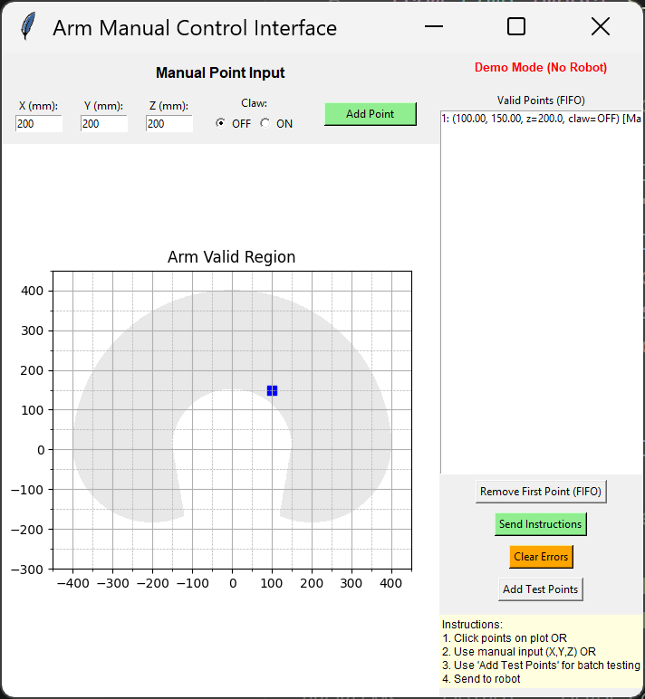
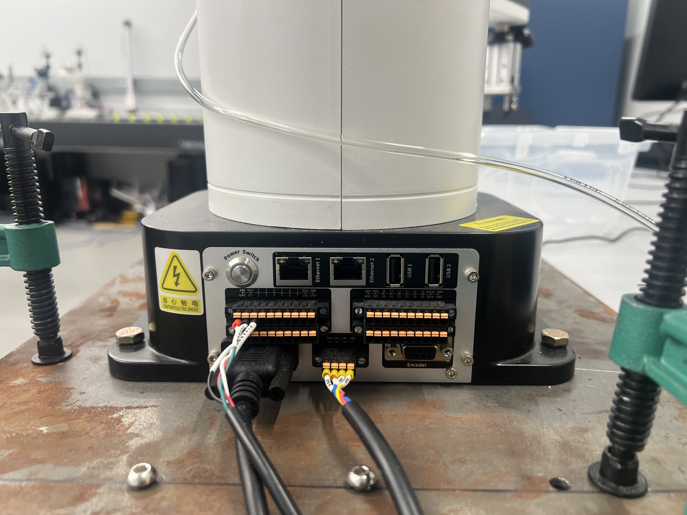
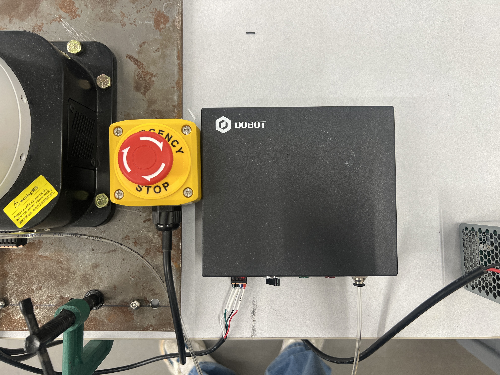

# Robotic Arm Controller + Object-Detection Training

A Python application that controls a Dobot robotic arm by inputting **Cartesian coordinates (X, Y, Z)**, plus the full pipeline used to **train and evaluate the object detectors** (YOLO and the RF-DETR vision transformer) that identify what the arm's laser is pointing at.

**Future version**: will allow control through **individual joint angles**, enabling movement by controller and later by AI.

## Contents
1. [What's in this repo](#whats-in-this-repo)
2. [Features](#features)
3. [Setup and Installation (arm app)](#setup-and-installation)
4. [Using the GUI](#using-the-gui-while-mainpy-is-running) / [GUI tabs](#gui-tabs-overview) / [Network connection](#network-connection-ethernet-2)
5. [Integration with 4DAI Server](#integration-with-4dai-server)
6. [**Training the detectors (YOLO + transformer)**](#training-the-detectors-yolo-vs-rf-detr-transformer)
7. [Where the weights are stored](#where-the-weights-are-stored)
8. [Running a trained model](#running-a-trained-model)
9. [Video walkthroughs](#video-walkthrough-arm-demo) (arm demo, then the [training video spot](#video-walkthrough-training-transformers-yolo-and-weights))

## What's in this repo

| path | what it is |
|---|---|
| `main.py`, `Interface.py`, `dobot_util/` | The arm control GUI and the Dobot library |
| `vision/` | Config, MQTT messaging, storage (Mongo/CSV/Excel/Roboflow), laser + camera services |
| `laser_control/`, `ESP32_Laser_Control/` | Python client and PlatformIO firmware for the ESP32 laser controller |
| `server-4dai/` | The 4DAI FastAPI + Streamlit server that takes the photos |
| `scripts/object_labeling_studio.py` | Standalone tool to finish labeling captures and push boxes to Roboflow |
| `dataset/` | YOLO-format dataset config (`data.yaml`, `data.corrected.yaml`), label PDFs and build reports. The `train/`, `valid/`, `test/` image + label folders must sit here to train (see below) |
| `dataset_stats/`, `stats_after_split/` | Dataset audit script and its latest report/charts |
| `training_scripts/yolo/` | Train / evaluate / sort errors for **YOLO** (ultralytics) |
| `training_scripts/transformer/` | Train / evaluate / sort errors for **RF-DETR** (vision transformer) |
| `training_scripts/common/` | Dataset prep, shared error-sorting rules, example collector, model comparison |
| `KNOWN_ISSUES.md` | Open bugs on the capture flow |

## Features
- Move the robotic arm by specifying X, Y, Z coordinates
- Visualize coordinates on an XY plot
- Maintain a FIFO list of coordinates to be executed by the arm

## Setup and Installation
This installs the **arm app** (`main.py`). Training dependencies are separate - see [Training the detectors](#training-the-detectors-yolo-vs-rf-detr-transformer).

Follow these steps to set up the project and install all required dependencies.

1. **Clone the repository**
```powershell
git clone https://github.com/yourusername/robotic-arm-controller.git
cd robotic-arm-controller
```
2. **Create a virtual environment**
```powershell
python -m venv venv
```
3. **Activate the virtual environment**
```powershell
.\venv\Scripts\Activate.ps1
```
4. **Install Dependencies**
```powershell
pip install -r requirements.txt
```
5. **Run the Application**
```powershell
python main.py
```

## Using the GUI (while `main.py` is running)
When you start the application with `python main.py`, the GUI window will open and let you plot and send coordinate sequences to the robotic arm. Below are general usage instructions and recommended workflows.

- **Plotting points**: Use the plot area to add or visualise points in the XY plane. Depending on the GUI controls you can typically add points by clicking the plot or by entering exact coordinates in the input fields.
- **Adding coordinates to the list**: Enter coordinates using the provided input fields (X, Y, Z) and press the button to append them to the coordinate list. The list follows a FIFO protocol: the oldest coordinate will be executed first when you send the list to the arm.
- **Editing / Removing points**: Use the list controls to remove or reorder entries before sending. If the GUI supports it, select a point and delete or edit the values.
- **Sending to the arm**: There is a control/button to send the queued coordinate list to the robotic arm. Press it to begin execution. Monitor the GUI for status updates or errors.
- **Start / Stop / Pause**: Use the provided start/stop/pause controls to control execution. If your GUI does not have pause, stop will typically abort execution and clear or retain the queue depending on settings.

### Coordinate format
- Coordinates are Cartesian triples: `X, Y, Z` (units depend on your arm configuration, commonly millimeters).
- Example entry: `X: 150, Y: 0, Z: 100`
- Example list (pseudo-format):
```
[(150, 0, 100), (160, 20, 90), (140, -20, 95)]
```

### Typical workflow
1. Start the application: `python main.py` and wait for the GUI window.
2. Use the plot or input fields to add the desired waypoints to the list.
3. Verify the order of waypoints in the FIFO list. Edit or remove any points as needed.
4. Click `Send` (or equivalent) to begin execution on the robotic arm.
5. Monitor the status in the GUI and use `Stop` immediately if anything behaves unexpectedly.

### Safety & troubleshooting
- **Safety first**: Keep a safe distance from the arm during motion. Ensure no objects or people are inside the workspace when commanding moves.
- **Limits**: If a coordinate is outside the robot's reachable workspace, the arm may error or behave unpredictably. Validate coordinates before sending.
- **Connection errors**: If the GUI cannot communicate with the arm, check cables, power, and the device connection settings (serial port, IP, etc.). Restart the app after fixing connection issues.
- **Logs / Errors**: Check the terminal running `main.py` for log output and error messages — they usually provide clues for what went wrong.

## Example
1. Add three points: `(150, 0, 100)`, `(160, 20, 90)`, `(140, -20, 95)`.
2. Confirm order in the FIFO list.
3. Click `Send` to move the arm through the points in order.

## GUI Tabs Overview
`main.py`'s GUI is organized into six tabs. Screenshots below reflect the
current layout.

### Arm
Direct physical control only: the Height Floor / Hard Deck safety limit,
keyboard/manual jog overdrive, the manual XYZ and joint-move point
controls, and the FIFO point queue. No Control Mode or Middleman UI lives
here — see the "Virtual" tab for that.


### Virtual
Control Mode selection (Demo / Physical Manual / Middleman — Physical
Side / Middleman — Other Side) and every Middleman-specific panel: the
remote controller queue, the Physical Side discovery/connect dropdown,
remote capture, and remote laser toggles.


### Camera
The "Capture Photo" action sits at the top of this tab — it's the flow
that actually stores something: it saves each configured camera's frame
locally, logs the sample to the local MongoDB, and uploads it to the
server URL configured on the "Server" tab. An optional "Sample name"
field lets you tag a capture (e.g. `test_object`) so it's easy to find
again later on the "Database" tab. Below that is the live multi-camera
feed and camera device-index assignment.


### Laser
The ESP32 laser controller: serial connect/disconnect, PWM
configure/arm/fire, and the per-channel relay on/off toggles (up to 4
relay-switched laser diodes). The Python client that talks to it lives
in `laser_control/`; the board-side firmware it talks to is the
PlatformIO project in [`ESP32_Laser_Control/`](ESP32_Laser_Control)
(`src/main.cpp`) — flash that onto the ESP32 with `pio run -t upload`
from inside that folder.


### Server
The server URL used for uploads (test-local by default), a connection
test, and the server-triggered continuous-sweep automation.


### Database
Browse recent local captures (double-click a row to view its photo(s) in
a popup viewer, shown below) and, if Ollama is running locally, ask
plain-English questions against the local MongoDB via the "Ask (local
AI, temporary)" panel.


**Sample photo viewer** (opens when you double-click a row on the
Database tab):


## Images






## Mac compatibility
This project works on macOS with these small adjustments. Use `python3` on macOS and create/activate the virtual environment as shown below.

1. Create venv:
```bash
python3 -m venv venv
```
2. Activate venv (macOS / Bash / Zsh):
```bash
source venv/bin/activate
```
3. Install dependencies:
```bash
pip install -r requirements.txt
```
4. Run the application:
```bash
python3 main.py
```

Notes for macOS users:
- If you use a conda environment, you can skip the `venv` steps and use `conda activate` instead.
- If any GUI libraries require a specific backend on macOS (e.g., for matplotlib), the terminal logs will indicate missing backends; install the required packages (for example, `pip install pyobjc-framework-Quartz` or follow the library-specific instructions).

## Network connection: Ethernet 2
To interact with the robot the PC must be connected to the robot controller over Ethernet. On Windows the GUI expects the network link on the machine's Ethernet adapter named or routed through `Ethernet 2` (this is how our environment is set up). On macOS and other platforms the same idea applies: connect the PC's Ethernet port directly to the robot controller (or to the switch on the same subnet) and ensure your machine's interface is on the same subnet as the robot.

Steps to configure the connection (generic):
1. Physically connect an Ethernet cable between your computer and the robot controller or switch.
2. Identify the local interface that corresponds to that port (Windows: `Ethernet 2`; macOS: likely `en0`, `en1`, or a Thunderbolt Ethernet adapter). Use System Preferences/Settings → Network or `ifconfig`/`ipconfig` to identify the interface.
3. Assign a static IP on the same subnet as the robot controller. Example (macOS):
```bash
# replace en0 with your interface name and choose an IP in the robot's subnet
sudo ifconfig en0 inet 192.168.1.100 netmask 255.255.255.0
```
On Windows use the GUI network settings to set a manual IPv4 address that matches the robot's subnet and use `Ethernet 2` as the active interface.
4. Connect from the GUI using the robot's IP address (enter it in the GUI's connection field or ensure the GUI is configured to use the same interface). If you don't know the robot's IP, check the robot controller documentation, or scan the local subnet with a network tool (for example `nmap`) to locate the device.

Troubleshooting tips:
- If the GUI shows "Demo Mode (No Robot)", check that the Ethernet interface is up and that the selected interface is the one connected to the robot.
- Ensure any OS firewall is disabled or configured to allow the GUI application to communicate on the local network.
- If you cannot reach the robot, try pinging the robot IP from a terminal to confirm connectivity.


## Integration with 4DAI Server

This arm no longer owns any camera hardware directly. Photo capture has
been handed off entirely to the **4DAI server** — when the arm wants a
photo taken (during a pickup/photograph sequence or a sweep), it sends a
capture trigger over HTTP, and 4DAI's Streamlit UI takes the photo using
the browser's webcam and saves it. The arm never touches `cv2`, a
webcam, or a live camera preview anymore.

The 4DAI server code lives in this repo under [`server-4dai/`](server-4dai/).

> **Note on this merged codebase:** the local-camera pipeline (`CAMERAS` in
> `vision/config.py`, the Live Camera Feed panel, `pickup_photograph_and_identify`,
> `run_automatic_capture_sequence`) is still present and still the default —
> it was kept as the base. The 4DAI-server-triggered versions of the
> capture pipeline live alongside it under a `_server_dependent` suffix
> (e.g. `pickup_photograph_and_identify_server_dependent`,
> `run_pickup_photograph_and_identify_server_dependent`,
> `_handle_capture_command_server_dependent`), plus the standalone
> `run_continuous_sweep` feature and its "Continuous Sweep Automation" UI
> panel, which have no local-camera equivalent.

### How the two sides talk to each other
- The arm POSTs to `{FOURDAI_API_URL}/collection/trigger-webcam-capture`
  whenever it wants a photo taken.
- 4DAI's UI polls `/collection/check-trigger` and, when a trigger comes
  in, switches to the Collection page (requesting webcam permission if
  it hasn't been granted yet) and takes the photo.
- `FOURDAI_API_URL` is set in `vision/config.py` on the arm side —
  `http://localhost:8000` for local testing (`TEST_MODE = True`), or the
  real server address if the arm and server are on separate machines.

### Starting the local 4DAI server
Run these from `server-4dai/`, in order:

1. **Start MongoDB**
   ```bash
   mongosh   # confirms it connects; Ctrl+D to exit
   ```

2. **Start the FastAPI backend**
   ```bash
   cd Server
   uvicorn main:app --host 0.0.0.0 --port 8000
   ```
   Leave this running — this is what both the arm and the Streamlit UI
   talk to.

3. **Start the Streamlit UI** (in a separate terminal)
   ```bash
   cd UI
   streamlit run home.py
   ```
   Opens at `http://localhost:8501`. Check `UI/key.py` points `URL` at
   the running server (`http://localhost:8000` for local testing).

4. **Grant camera permission once, up front.** Open any category's
   Collection page in the browser and allow webcam access before
   relying on automatic capture from the arm — the camera widget has to
   be visible on-screen for the browser to prompt for permission at all.

With both the arm (`python main.py`) and the 4DAI server/UI running
locally, a pickup-and-photograph sequence on the arm should trigger a
photo automatically in the browser and save it under
`server-4dai/images/<category>/auto_capture/`.

See [`server-4dai/README.md`](server-4dai/README.md) for the full server
setup and troubleshooting details.

## Training the detectors: YOLO vs RF-DETR (transformer)

Two detectors are trained on the **same dataset** (47 classes, ~1,700 images: 1,365 train / 340 valid) and scored with the **same rules**, so results are directly comparable.

| | **YOLO** | **RF-DETR (the transformer)** |
|---|---|---|
| Library | `ultralytics` | `rfdetr` (Roboflow) |
| Architecture | CNN, single-stage | Vision transformer (DINOv2 backbone), DETR-style |
| Folder | `training_scripts/yolo/` | `training_scripts/transformer/` |
| Train script | `train_yolo.py` | `train_rfdetr.py` |
| Error-sort script | `sort_yolo_errors.py` | `sort_rfdetr_errors.py` |

Each dataset class name is really three labels glued together (`Object X - Material Y - Color Z - Pdfname W`), so evaluation is reported at four levels: **exact class**, **object**, **material**, **color**, plus a weighted composite (`0.6 x object + 0.3 x material + 0.1 x color`). Full explanation and diagrams: [`training_scripts/README.md`](training_scripts/README.md).

> All commands below are written for PowerShell/cmd or bash (forward slashes work in both on Windows). Run each block from the folder named in its first comment.

### 0. One-time setup

```bash
# from the repo root, with your venv active
pip install pdfplumber pyyaml pillow matplotlib      # dataset tools, plots, diagrams
pip install ultralytics                              # YOLO
pip install "rfdetr[train]"                          # transformer (RF-DETR)
pip install roboflow                                 # only for yolo/upload_to_roboflow.py
```

For GPU training install a **CUDA build of PyTorch first** (<https://pytorch.org/get-started/locally/>) and confirm it:

```bash
python -c "import torch; print(torch.cuda.is_available())"   # must print True
```

**Dataset layout expected** (YOLO format, at `dataset/`):

```
dataset/
  data.yaml  data.corrected.yaml      <- class names (47 classes); scripts prefer data.corrected.yaml
  train/{images,labels}  valid/{images,labels}  test/{images,labels}   <- test is optional
```

The image folders are not committed with the code - drop your `train/ valid/ test/` folders into `dataset/` (e.g. from Roboflow's YOLOv8 export) before training. Nothing in `dataset/` is ever modified by the training scripts.

### 1. Prepare and audit the dataset

```bash
# training_scripts/common/  - read-only check of labels vs the label PDFs, writes dataset/dataset_build_report.txt
cd training_scripts/common
python build_dataset.py --dataset-dir ../../dataset

# optional: rebuild splits so every object appears in both train and valid (80/20)
python resplit_dataset.py --dataset-dir ../../dataset --mode stratified --train-ratio 0.8 --val-ratio 0.2 --apply-in-place

# optional: draw the labels on the images to eyeball them
python visualize_annotations.py --help

# dataset audit (counts per class/object/material/color, duplicates, box sizes, train/valid leakage)
cd ../../dataset_stats
python dataset_stats.py --dataset-dir ../dataset --out dataset_stats_out
```

Read `dataset/dataset_build_report.txt` before training. More options: [`training_scripts/common/README.md`](training_scripts/common/README.md) and [`dataset_stats/README.md`](dataset_stats/README.md).

### 2. Train the transformer (RF-DETR)

```bash
cd training_scripts/transformer

# Standard run: pretrained COCO weights, small model, 100 epochs, early stopping
python train_rfdetr.py --dataset-dir ../../dataset --model small --epochs 100 --patience 15 --device cuda --no-amp --name pretrained

# Low-memory run (the one used for the current results: 6 GB GTX 1660 Ti)
python train_rfdetr.py --dataset-dir ../../dataset --model nano --epochs 100 --batch 2 --grad-accum 8 --resolution 512 --device cuda --no-amp --workers 0 --patience 20 --name nano_lowmem

# Control experiment: no pretrained weights (needs more epochs / patience)
python train_rfdetr.py --dataset-dir ../../dataset --model small --epochs 250 --patience 40 --device cuda --no-amp --from-scratch --name scratch

# Evaluate an existing checkpoint only (no training)
python train_rfdetr.py --dataset-dir ../../dataset --eval-only --weights runs/rfdetr/nano_lowmem/checkpoint_best_total.pth
```

| flag | meaning |
|---|---|
| `--model nano\|small\|medium\|base\|large` | Model size. With this small a dataset `nano`/`small` are the sensible picks |
| `--batch` x `--grad-accum` | Effective batch size (default 4 x 4 = 16). Lower `--batch`, raise `--grad-accum` if you run out of GPU memory |
| `--resolution` | Input size; smaller = less memory (512 used for the low-memory run) |
| `--no-amp` | Full fp32. Use on GTX 16-series cards to avoid fp16/cuDNN errors |
| `--workers 0` | Use if training hangs on Windows |
| `--patience N` | Early stopping (0 disables) |
| `--from-scratch` | Skip pretrained COCO weights (almost always much worse on a dataset this small) |
| `--name` | Run folder name under `runs/rfdetr/` |

Pretrained COCO weights download automatically on first run (needs internet). Re-running a command with the same `--name` starts over; there is no resume option yet. Roughly 6 min/epoch for `small` on a GTX 1660 Ti.

**After training** (still in `training_scripts/transformer/`):

```bash
# Sort every validation image into correct/ and failure/<type>/ (green = truth, red = model)
python sort_rfdetr_errors.py --dataset-dir ../../dataset --weights runs/rfdetr/nano_lowmem
python sort_rfdetr_errors.py --dataset-dir ../../dataset --weights runs/rfdetr/nano_lowmem --split test --conf 0.2

# Loss / mAP curves (add several run folders to overlay them, e.g. pretrained vs scratch)
python plot_rfdetr_loss.py runs/rfdetr/nano_lowmem
python plot_rfdetr_loss.py runs/rfdetr/pretrained runs/rfdetr/scratch

# Copy 2 example images per error type into results/ for the README gallery
python ../common/collect_examples.py --sorted-dir runs/rfdetr/nano_lowmem/error_sort_valid --out-dir results
```

Details and the example gallery: [`training_scripts/transformer/README.md`](training_scripts/transformer/README.md).

### 3. Train YOLO

```bash
cd training_scripts/yolo

# Standard run (yolov8s fits a 6 GB card at imgsz 640, batch 16) and evaluate straight away
python train_yolo.py --dataset-dir ../../dataset --model yolov8s.pt --epochs 100 --device 0 --cache ram --evaluate

# Faster/smaller baseline
python train_yolo.py --dataset-dir ../../dataset --model yolov8n.pt --epochs 100 --imgsz 640 --batch 16 --device 0 --cache ram --workers 4

# Turn off colour jitter (laser colour / glow carries information), use geometric augmentation instead
python train_yolo.py --dataset-dir ../../dataset --device 0 --cache ram --no-color-aug --degrees 10 --translate 0.15 --fliplr 0 --name noColorAug

# Continue an interrupted run
python train_yolo.py --dataset-dir ../../dataset --resume
```

| flag | meaning |
|---|---|
| `--model` | `yolov8n.pt` (default) / `yolov8s.pt` / `yolov8m.pt` (needs `--batch 8` on 6 GB, likely overfits here) |
| `--device 0` | Force the GPU so it can't silently fall back to (10-50x slower) CPU |
| `--cache ram` | Cache decoded images in RAM; the dataset is tiny so this is basically free |
| `--workers` | Try `0` or `4` on Windows if training feels slow |
| `--no-color-aug`, `--hsv-*`, `--degrees`, `--translate`, `--scale`, `--shear`, `--fliplr`, `--flipud`, `--mosaic` | Augmentation controls |
| `--project` / `--name` | Where the run is saved (default `runs/train/<name>`) |
| `--evaluate` | Run `evaluate.py` on the best checkpoint when training ends |

**After training** (still in `training_scripts/yolo/`):

```bash
# Metrics: precision / recall / mAP50 / mAP50-95 per class, object, material, color (+ weighted composite)
python evaluate.py --weights runs/detect/runs/train/exp/weights/best.pt --dataset-dir ../../dataset
python evaluate.py --weights runs/detect/runs/train/exp/weights/best.pt --dataset-dir ../../dataset --split test

# Sort every validation image into correct/ and failure/<type>/ (same rules as RF-DETR)
python sort_yolo_errors.py --dataset-dir ../../dataset --weights runs/detect/runs/train/exp/weights/best.pt

# One image per object: ground truth vs model predictions side by side
python compare_predictions.py --weights runs/detect/runs/train/exp/weights/best.pt --dataset-dir ../../dataset

# Compare two YOLO checkpoints (fixed / regressed / still wrong), or run the whole report in one go
python compare_model_errors.py --weights-a .../baseline/weights/best.pt --weights-b .../noColorAug/weights/best.pt --label-a baseline --label-b no_color_aug --dataset-dir ../../dataset
python run_full_error_report.py --weights-a .../baseline/weights/best.pt --label-a baseline --weights-b .../noColorAug/weights/best.pt --label-b no_color_aug --dataset-dir ../../dataset

# Quick 1-epoch smoke test of the whole train -> evaluate pipeline (~2 min), before a long run
python test_pipeline.py --dataset-dir ../../dataset

# Export for deployment (ONNX by default; also TensorRT, OpenVINO, CoreML, TFLite...)
python export_weights.py --weights runs/detect/runs/train/exp/weights/best.pt --imgsz 640 --simplify --quantize 16

# Optional: push the dataset to Roboflow (preview first, then --upload)
python upload_to_roboflow.py --dataset-dir ../../dataset --project your-project-slug
```

Training curves: copy ultralytics' `results.png` from the run folder to `yolo/results/training_curves.png`. Details and the YOLO example gallery: [`training_scripts/yolo/README.md`](training_scripts/yolo/README.md).

### 4. Compare YOLO vs the transformer

Run both sorters with the **same `--split`, `--conf` and `--iou`**, then:

```bash
cd training_scripts
python common/compare_models.py --yolo-dir yolo/runs/detect/runs/train/exp/error_sort_valid --transformer-dir transformer/runs/rfdetr/nano_lowmem/error_sort_valid --out-dir comparison
```

This writes `comparison/comparison.png`, `comparison.txt` and `comparison.csv`. `compare_models.py` warns if the two runs used different thresholds.

### Latest results snapshot (RF-DETR nano, `nano_lowmem`, validation split)

| metric | value |
|---|---|
| COCO mAP50 | 0.944 |
| COCO mAP50-95 | 0.454 |
| precision / recall / F1 (COCO evaluator) | 0.946 / 0.883 / 0.902 |
| exact-class precision / recall / F1 (conf 0.3, IoU 0.5) | 0.873 / 0.921 / 0.896 |
| weighted composite F1 (object/material/color) | 0.925 |
| true positives / false positives / false negatives | 315 / 46 / 27 (of 342 labelled objects) |

Source: `training_scripts/transformer/runs/rfdetr/nano_lowmem/eval_val/evaluation_report_val.txt`. The P/R/F1 numbers are not directly comparable with YOLO's mAP columns; use the error-sorting comparison above for a like-for-like view.

## Where the weights are stored

Weights are created by the training scripts and are **not committed to git** (they are large). After a run they live here, relative to the script's folder:

| model | file | location after training |
|---|---|---|
| **RF-DETR (transformer)** | best checkpoint | `training_scripts/transformer/runs/rfdetr/<name>/checkpoint_best_total.pth` |
| | other checkpoints | `checkpoint_best_ema.pth`, `checkpoint_best_regular.pth` in the same folder |
| | run config + metrics | `training_config.json`, `metrics.csv`, `loss_curves.png`, `eval_val/` in the same folder |
| | staged dataset copy | `<run>/dataset_staged/` (safe to delete) |
| **YOLO** | best weights | `training_scripts/yolo/runs/detect/runs/train/<name>/weights/best.pt` |
| | last epoch | `.../weights/last.pt` |
| | curves + metrics | `.../results.png`, `.../results.csv` |
| | exported model | next to the weights (e.g. `best.onnx`) after `export_weights.py` |

Current run on disk: `runs/rfdetr/nano_lowmem/` (config, metrics, curves and evaluation only; the `.pth` checkpoint stays on the training machine).

> The `runs/detect/runs/train/...` nesting is how the installed ultralytics version lays out `--project runs/train`. If yours differs, `train_yolo.py` prints the real save path at the end of training.

**Sharing / backing up weights:** copy the whole `runs/rfdetr/<name>/` folder (or just the `.pth`) and `weights/best.pt` to a shared drive or a GitHub Release. Don't commit them to the repo. <!-- TODO: add link to where the final weights are hosted -->

## Running a trained model

**Evaluate / sort a whole split** (what the scripts above do) is the easiest way to run either model end to end. To run a single image yourself:

```python
# YOLO
from ultralytics import YOLO
model = YOLO("training_scripts/yolo/runs/detect/runs/train/exp/weights/best.pt")
results = model.predict("some_photo.jpg", conf=0.3, imgsz=640, device=0)
results[0].show()

# RF-DETR (transformer) -- pick the same size you trained: RFDETRNano / RFDETRSmall / ...
from rfdetr import RFDETR
from PIL import Image
model = RFDETR.from_checkpoint("training_scripts/transformer/runs/rfdetr/nano_lowmem/checkpoint_best_total.pth")
detections = model.predict(Image.open("some_photo.jpg"), threshold=0.3)
print(detections.class_id, detections.confidence, detections.xyxy)   # class ids index data.corrected.yaml names
```

Class ids map to the names in `dataset/data.corrected.yaml` (index 0 = first entry under `names:`).

> **Note:** the arm app's `vision/model/classifier.py` is still a stub (`identify()` returns a label, confidence and attributes). Wiring a trained checkpoint behind that function is what connects these detectors to the arm's capture pipeline.


## Video Walkthrough: Arm Demo

[](https://youtu.be/GgRfbci3YlA)

---

## Video Walkthrough: Training, Transformers, YOLO and Weights

> 🎬 **VIDEO PLACEHOLDER - to be filmed and added.**
> Replace this block with the link once the video is uploaded.

<!-- When the video is uploaded, replace VIDEO_ID below and delete the "coming soon" line:
[](https://youtu.be/VIDEO_ID)
-->

**Video: _coming soon_**  (link: `TODO`)

**What the video will cover** (check off as filmed):

- [ ] Project tour: arm app, `vision/`, `training_scripts/`, `dataset/`
- [ ] The dataset: classes (`Object - Material - Color - Pdfname`), train/valid split, `dataset_stats`
- [ ] **Training the transformer (RF-DETR):** the `train_rfdetr.py` command, model sizes, low-memory flags, watching the loss curves
- [ ] **Training YOLO:** the `train_yolo.py` command, GPU check, augmentation flags
- [ ] **Where the weights are stored** for each model (`checkpoint_best_total.pth` and `weights/best.pt`) and how to back them up
- [ ] **How to run each model** on a split (`sort_rfdetr_errors.py`, `sort_yolo_errors.py`) and on a single image
- [ ] Reading the results: metrics, the error-type folders (wrong object / material / color, missed, false positives), YOLO vs transformer comparison
- [ ] Hooking a trained model into the arm app (`vision/model/classifier.py`)
- [ ] Live demo: laser hitting an object -> detection

**Video link:** https://youtu.be/7z5Cr6MiunY ·  **Weights download:** _add here_  ·  **Recorded on:** 10/25/2026
