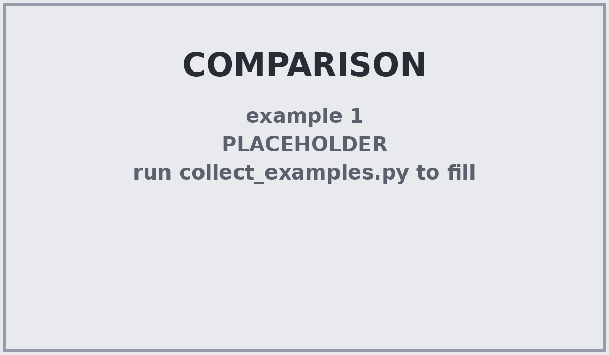

# Object detection: YOLO vs RF-DETR (vision transformer)

Two detectors trained and evaluated on the **same dataset**, with the **same
rules** for deciding what counts as correct, so their results can be compared
directly. The dataset's class names are `Object X - Material Y - Color Z -
Pdfname W`, which is why evaluation is reported at several levels (exact class,
object, material, color) and why mistakes are sorted into *kinds* of wrong.

## Folders

| folder | what's in it |
|---|---|
| [`yolo/`](yolo/README.md) | Train and evaluate a **YOLO** (ultralytics) model, plus `sort_yolo_errors.py` |
| [`transformer/`](transformer/README.md) | Train and evaluate **RF-DETR** (Roboflow's vision transformer), plus `sort_rfdetr_errors.py` and loss-curve plotting |
| [`common/`](common/README.md) | Dataset tools (PDF labels -> `data.yaml`, resplit, visualize), the **shared error-sorting rules**, example collector, and `compare_models.py` |
| [`diagrams/`](diagrams/) | The four evaluation diagrams below; `make_diagrams.py` redraws them |
| `comparison/` | Where `compare_models.py` writes the YOLO vs RF-DETR comparison (placeholder until you run it) |

Each of `yolo/` and `transformer/` has its own README with the commands, what
the outputs mean, and a gallery of example images for every error type that you
fill in after your runs.

## How evaluation works

Every image goes through the same steps for both models:


The dataset's class name is really three labels glued together. A prediction can
get the **exact class** wrong while still getting the **object** right, which is
why the reports score several levels:


- **Overall** = exact class only: object *and* material *and* color all right.
- **Object / Material / Color** = each part scored separately (every class that
  shares that part is pooled together).
- **Composite** = `0.6 x Object + 0.3 x Material + 0.1 x Color` (weights are
  adjustable) -- partial credit that rewards getting the object right first.

### What kind of mistake was it?

Every mistake is given one of eleven names, and `sort_*_errors.py` files each
image into a folder by its most serious one. When a box was found on a real
object:


When an object was missed, or a box has nothing under it:


| your question | folder(s) in `failure/` |
|---|---|
| wrong class (any kind) | `wrong_object`, `wrong_object_same_category`, `wrong_material`, `wrong_color`, `wrong_material_and_color`, `wrong_class_same_attributes` |
| wrong object | `wrong_object`, `wrong_object_same_category` |
| wrong material | `wrong_material`, `wrong_material_and_color` |
| wrong color | `wrong_color`, `wrong_material_and_color` |
| false negative (object missed) | `missed_no_detection`, `missed_low_confidence`, `poor_localization` |
| false positive (extra box) | `false_positive_background`, `false_positive_duplicate` |

The rules are in one file, [`common/error_sorting.py`](common/error_sorting.py),
used by both sorters, so a "wrong material" for YOLO means exactly what it does
for RF-DETR. An image goes in the folder of its *most serious* failure; the CSVs
list every mistake individually.

## Quick start (Windows)

```
cd C:\Users\finns\Downloads\roboticsarmAI\yolo_training_scripts

:: 0. dataset prep (once, or whenever the PDFs change)
cd common
python build_dataset.py --dataset-dir ..\..\dataset
cd ..

:: 1a. YOLO
cd yolo
python train_yolo.py --dataset-dir ..\..\dataset --model yolov8s.pt --epochs 100 --device 0 --cache ram --evaluate
python sort_yolo_errors.py --dataset-dir ..\..\dataset --weights runs\detect\runs\train\exp\weights\best.pt
cd ..

:: 1b. RF-DETR
cd transformer
python train_rfdetr.py --dataset-dir ..\..\dataset --model small --epochs 100 --device cuda --no-amp --name pretrained
python sort_rfdetr_errors.py --dataset-dir ..\..\dataset --weights runs\rfdetr\pretrained
python plot_rfdetr_loss.py runs\rfdetr\pretrained
cd ..

:: 2. compare the two (same split, same --conf / --iou!)
python common\compare_models.py --yolo-dir yolo\runs\detect\runs\train\exp\error_sort_valid --transformer-dir transformer\runs\rfdetr\pretrained\error_sort_valid --out-dir comparison
```

Run the sorters with the **same `--split`, `--conf` and `--iou`** for both
models; `compare_models.py` warns if they differ.

## Head-to-head results (fill in after your runs)


*`compare_models.py --out-dir comparison` overwrites this picture and writes `comparison.txt` / `comparison.csv` next to it.*

| | YOLO | RF-DETR |
|---|---|---|
| images fully correct | | |
| objects found with exact class | | |
| wrong class (any kind) | | |
| wrong object | | |
| wrong material | | |
| wrong color | | |
| false negatives (missed) | | |
| false positives (extra boxes) | | |

## Moving from the old single-folder layout

The scripts used to sit in one folder. Old training output (`runs\...`) stays
where it is -- either move it (e.g. `runs\rfdetr` into `transformer\runs\rfdetr`)
or point at it with `..\runs\rfdetr\pretrained`. Nothing else changed: every
script still takes the same arguments, and each one finds the shared code in
`common\` by itself.

## Dependencies

```
pip install pdfplumber pyyaml pillow matplotlib      # dataset tools, diagrams, plots
pip install ultralytics                              # yolo/
pip install "rfdetr[train]"                          # transformer/
pip install roboflow                                 # only for yolo/upload_to_roboflow.py
```
Install a CUDA build of PyTorch first if you want GPU training
(<https://pytorch.org/get-started/locally/>).
